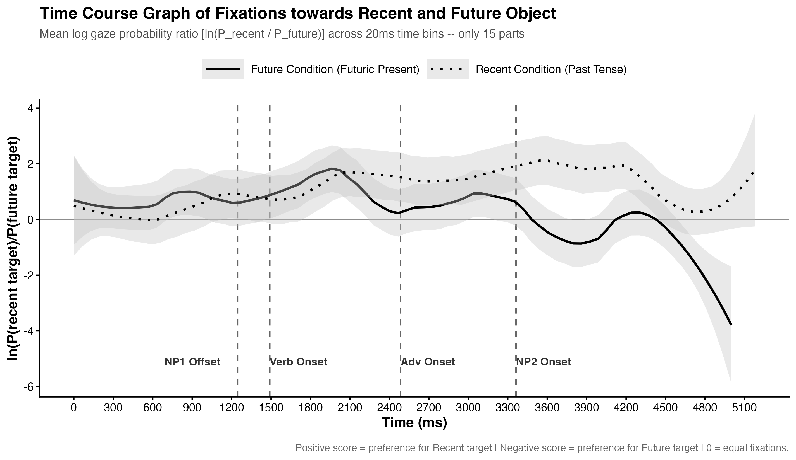

# Eye-Tracking Data Analysis in R

## Overview

This project demonstrates an end-to-end **R-based data analysis workflow for eye-tracking data** collected in a psycholinguistic experiment.

The workflow covers data import, quality control, data cleaning, temporal binning, integration of stimulus metadata, Area of Interest (AOI) mapping, participant-level aggregation, and time-course visualization.

The project is part of my **Data Science portfolio**, with a focus on reproducible data processing, exploratory analysis, statistical reasoning, and visualization.

## Research Question

The analysis investigates how participants' visual attention changes over time when processing linguistic information.

The main analysis examines the relative probability of fixating on Areas of Interest (AOIs) associated with **Recent vs. Future discourse referents**.

## Analytical Workflow

The analysis follows a reproducible pipeline:

```text
Raw eye-tracking data
        ↓
Data import
        ↓
Quality control & cleaning
        ↓
Temporal alignment
        ↓
20-ms time binning
        ↓
Stimulus metadata integration
        ↓
AOI mapping
        ↓
Participant-level aggregation
        ↓
Time-course visualization
```

### 1. Data Import

* Import eye-tracking data from multiple data files
* Import stimulus metadata
* Combine experimental datasets into a unified analysis dataset

### 2. Data Cleaning

* Inspect data structure and quality
* Apply fixation-duration criteria
* Calculate data retention and removal rates

### 3. Temporal Processing

* Align eye-tracking observations relative to the relevant linguistic event
* Divide the time course into **20-ms bins**

### 4. AOI and Metadata Integration

* Integrate eye-tracking observations with stimulus information
* Map Areas of Interest to Recent and Future discourse referents
* Create variables for subsequent analysis

### 5. Aggregation and Visualization

* Calculate gaze probabilities by participant and time bin
* Aggregate observations across participants
* Visualize changes in gaze allocation over time

## Measure

The main descriptive measure is the log probability ratio:

```text
ln(P(Recent) / P(Future))
```

Positive values indicate relatively greater fixation probability on the **Recent** AOI, whereas negative values indicate relatively greater fixation probability on the **Future** AOI.

## Results

The current version focuses on **data preparation, descriptive analysis, and visualization**.

### Time-course visualization



The aggregated time-course data are available in:

`results/tables/log_ratio_20ms_summary.csv`

## Project Structure

```text
R_eye-tracking-data-analysis/
│
├── R/
│   ├── 01_import_raw_data.R
│   ├── 02_clean_data.R
│   ├── 03_prepare_and_bin_data.R
│   └── 04_aggregate_and_visualize.R
│
├── results/
│   ├── figures/
│   │   ├── Fig3_log_ratio_timecourse.png
│   │   └── Fig3_log_ratio_timecourse.pdf
│   │
│   └── tables/
│       └── log_ratio_20ms_summary.csv
│
├── .gitignore
├── LICENSE
└── README.md
```

Raw and participant-level data are excluded from the public repository for data-protection reasons.

## Technologies

* R
* RStudio
* tidyverse
* dplyr
* ggplot2
* readxl
* janitor
* zoo
* reshape2
* Git
* GitHub

## Skills Demonstrated

* Data cleaning and preprocessing
* Data quality control
* Data transformation
* Data integration and joining
* Feature engineering
* Temporal data processing
* Participant-level aggregation
* Exploratory data analysis
* Data visualization
* Reproducible analysis workflows
* Version control with Git and GitHub

## Reproducibility

The analysis scripts are organized sequentially:

```text
01_import_raw_data.R
        ↓
02_clean_data.R
        ↓
03_prepare_and_bin_data.R
        ↓
04_aggregate_and_visualize.R
```

The workflow uses relative project paths and is designed to make the analysis steps transparent and reproducible.

Because the original dataset contains participant-level research data, the raw data are not included in this public repository.


## Current Status ##

The current version covers the **data-processing and descriptive-analysis stages** of the project.

Planned extensions include:

* Inferential statistical modeling
* Mixed-effects models
* Condition-level comparisons
* Model diagnostics
* Additional exploratory visualizations
* Further participant- and item-level analyses
